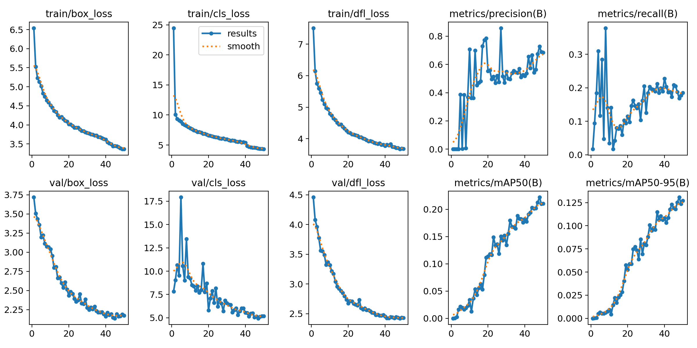
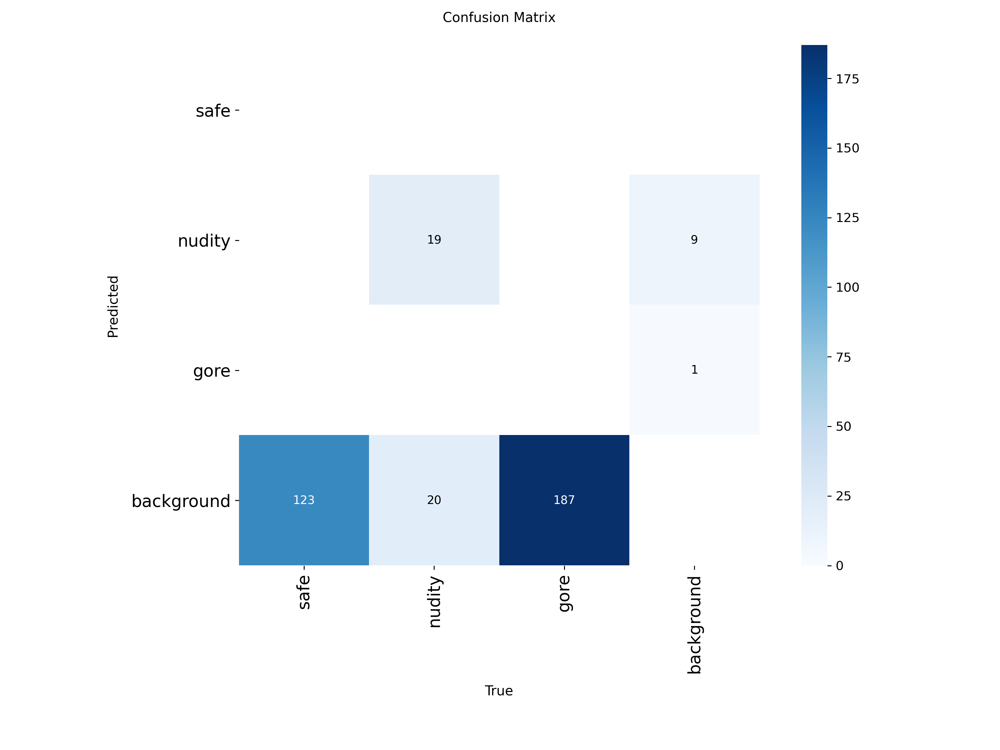
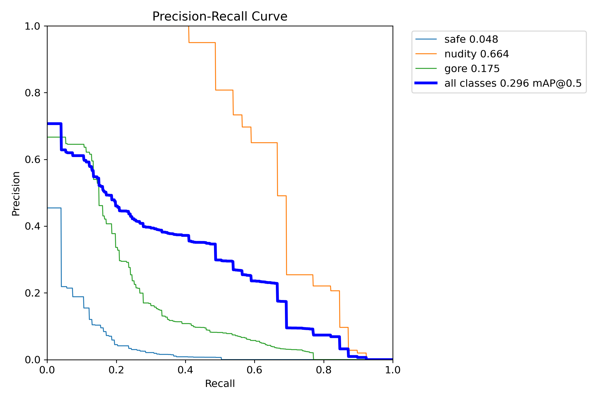
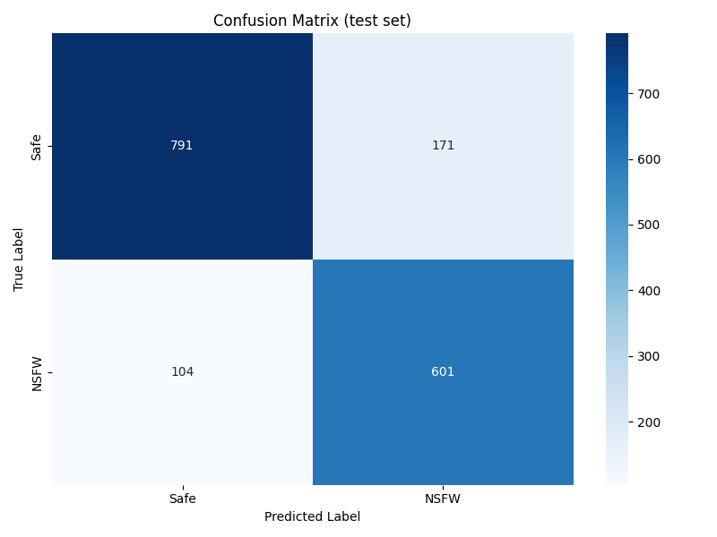
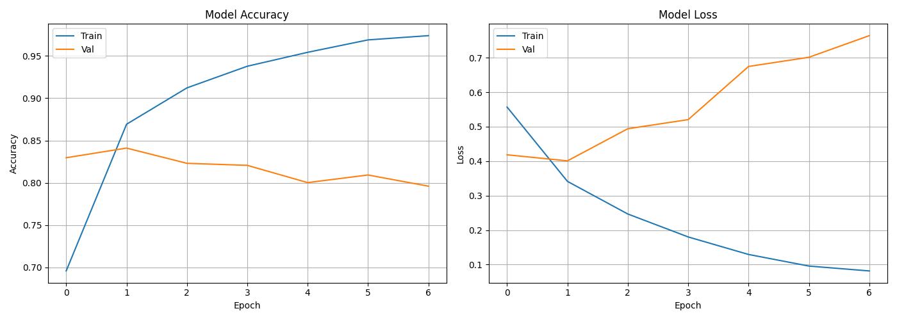

<div align="center">

# 🛡️ THESIS 1 — NSFW Content Detection

**Two lightweight, edge-deployable models for moderating unsafe on-screen content**
— images *and* Tagalog/Taglish text.

<!-- Badges -->


</div>

---

## 📑 Table of Contents

- [About](#-about)
- [Models at a Glance](#-models-at-a-glance)
- [Visual Detector — YOLOv10n](#-visual-detector--yolov10n)
- [Text Classifier — BiLSTM](#-text-classifier--bilstm)
- [Results](#-results)
- [Repository Layout](#-repository-layout)
- [Data & Weights](#-data--weights)
- [Getting Started](#-getting-started)
- [Known Issues](#-known-issues)
- [License](#-license)

---

## 📖 About

**THESIS 1** pairs two independent models to flag unsafe content shown on a
screen. Each is trained separately and exported to **TensorFlow Lite** for
on-device / mobile inference, so moderation can run without a network round-trip.

- 🖼️ **Vision** — detects unsafe imagery (`nudity`, `gore`) vs `safe`.
- 💬 **Language** — detects unsafe **Tagalog/Taglish** text (`NSFW` vs `Safe`).

---

## 🧩 Models at a Glance

| Module | Modality | Architecture | Task | Labels | Export |
|--------|----------|--------------|------|--------|--------|
| [`yolov10nver6/`](yolov10nver6/) | 🖼️ Image | YOLOv10-nano | Object detection | `safe`, `nudity`, `gore` | ONNX · SavedModel · TFLite |
| [`lstm_nsfw/`](lstm_nsfw/) | 💬 Text | Bidirectional LSTM | Binary classification | `Safe`, `NSFW` | Keras · TFLite |

---

## 🖼️ Visual Detector — YOLOv10n

A YOLOv10-nano object detector that locates and flags unsafe visual content.

- **Notebook:** [`yolov10nver5(1).ipynb`](yolov10nver6/yolov10nver5%281%29.ipynb)
  — houses the `ScreenContentDetector` training pipeline and a `TFLiteInference`
  wrapper (developed on Google Colab).
- **Classes:** `safe`, `nudity`, `gore` — see [`labelmap.txt`](yolov10nver6/output/labelmap.txt).
- **Training:** 50 epochs · 640px input · batch 16 · GPU
  ([`args.yaml`](yolov10nver6/runs/train/screen_content_detector/args.yaml)).
- **Exports:** ONNX, TF SavedModel, TFLite (float16 / float32).

---

## 💬 Text Classifier — BiLSTM

A two-layer Bidirectional LSTM that classifies Tagalog/Taglish text as safe or unsafe.

- **Notebook:** [`LSTM_NSFW_Detection.ipynb`](lstm_nsfw/LSTM_NSFW_Detection.ipynb)
  — an end-to-end, **config-driven** pipeline (every hyperparameter is read from
  [`config.yaml`](lstm_nsfw/config.yaml), the single source of truth):
  load → stratified split → train → evaluate → export TFLite → self-verify
  (developed on Google Colab).
- **Dataset:** ~11,110 labeled samples (`text,label`) — *not committed* (see [Data & Weights](#-data--weights)).
- **Split:** 70 / 15 / 15 stratified train / validation / **held-out test**. The test
  set is never used for training or checkpoint selection, so reported metrics are honest.
- **Training:** Adam · batch 64 · ≤20 epochs with early stopping (restores the best
  `val_loss` weights) · **class-weighted** loss to balance Safe/NSFW.
- **Architecture** ([`config.json`](lstm_nsfw/models/lstm_tagalog_nsfw/config.json)):

  | Hyperparameter | Value |
  |----------------|-------|
  | Vocabulary size | 10,000 |
  | Embedding dim | 128 |
  | LSTM units | 128 → 64 (two stacked bidirectional layers) |
  | Dense units | 64 → 32 |
  | Max sequence length | 128 |
  | Dropout / spatial dropout | 0.3 / 0.2 |

- **TFLite export:** training uses the fast cuDNN LSTM kernel; for export the notebook
  rebuilds a `use_cudnn=False` copy with a fixed batch-1 input and converts
  **builtins-only**, yielding a `model.tflite` that runs on a stock interpreter
  (**no Flex delegate**) and is verified to match the Keras model on smoke tests.
- **Artifacts:** `best_model.keras`, `final_model.keras`, `tokenizer.pickle`, `model.tflite` (*not committed*).

---

## 📊 Results

### YOLOv10n — Visual Detector

| Metric | mAP50 | mAP50-95 |
|--------|:-----:|:--------:|
| **Validation** | ~0.21 | ~0.13 |

<sub>Full per-epoch log: [`results.csv`](yolov10nver6/runs/train/screen_content_detector/results.csv)</sub>

<div align="center">

<br/>


</div>

### BiLSTM — Text Classifier

Evaluated on the **held-out test set** (1,667 samples, never seen during training):

| Class | Precision | Recall | F1 | Support |
|-------|:---------:|:------:|:--:|:-------:|
| Safe  | 0.884 | 0.822 | 0.852 | 962 |
| NSFW  | 0.779 | 0.853 | 0.814 | 705 |
| **Accuracy** | | | **0.835** | 1667 |

<sub>Full report: [`lstm_metrics.txt`](lstm_nsfw/metrics/lstm_metrics.txt) · NSFW **recall is
prioritised** (0.85) so unsafe text is rarely missed — tune via `threshold` in
[`config.yaml`](lstm_nsfw/config.yaml). GPU LSTM training is non-deterministic, so accuracy
varies ~0.835–0.845 run to run.</sub>

<div align="center">


</div>

---

## 🗂️ Repository Layout

```
THESIS_1/
├── yolov10nver6/                 # 🖼️ visual NSFW detector (YOLOv10n)
│   ├── yolov10nver5(1).ipynb     #   training + TFLite inference notebook
│   ├── config.yaml               #   pipeline settings (paths, hyperparameters)
│   ├── requirements.txt          #   Colab-pinned dependencies
│   ├── output/                   #   labelmap, eval metrics, inference results
│   └── runs/                     #   training/validation logs, plots, weights
└── lstm_nsfw/                    # 💬 text NSFW classifier (BiLSTM)
    ├── LSTM_NSFW_Detection.ipynb #   config-driven train + TFLite export notebook
    ├── config.yaml               #   model + data + training settings (single source)
    ├── requirements.txt          #   Colab-pinned dependencies
    ├── dataset.csv               #   (ignored) Tagalog text dataset
    ├── metrics/                  #   evaluation report (held-out test set)
    └── models/lstm_tagalog_nsfw/ #   config.json + (ignored) weights + model.tflite
```

---

## 🔒 Data & Weights

Large binaries are **excluded from version control** via [`.gitignore`](.gitignore):

| Excluded | Patterns |
|----------|----------|
| 📦 Datasets | `lstm_nsfw/dataset.csv`, `*.npy` |
| 🧠 Weights / exports | `*.pt`, `*.keras`, `*.tflite`, `*.onnx`, `*.pb`, `*.pickle`, SavedModel `variables/` |
| 🖼️ Raw image dumps | `train_batch*` / `val_batch*` previews, per-image inference outputs |

> ⚠️ Image dumps can contain dataset imagery (incl. NSFW content) — keep them out of the repo.
> Metrics, configs, plots, and the notebook **are** tracked so results stay auditable.
> Share datasets and trained weights out-of-band (e.g. Google Drive); they regenerate by re-running the notebooks.

---

## 🚀 Getting Started

Each model ships its own pinned `requirements.txt` (Colab-friendly, Python 3.12):

```bash
pip install -r yolov10nver6/requirements.txt   # visual detector
pip install -r lstm_nsfw/requirements.txt      # text classifier
```

> On Google Colab most deps are preinstalled — for the YOLO notebook, the in-notebook
> `pip install ultralytics` cell is usually enough.

**🖼️ Visual model**
Open the YOLO notebook and run the cells (designed for Colab). Settings (dataset path,
classes, epochs, weights) live in [`config.yaml`](yolov10nver6/config.yaml) — upload it
next to the notebook on Colab to override the built-in defaults, or just run as-is.

**💬 Text model**
```python
# Load tokenizer + model, then predict
import pickle, tensorflow as tf
from tensorflow.keras.preprocessing.sequence import pad_sequences

tok = pickle.load(open("lstm_nsfw/models/lstm_tagalog_nsfw/tokenizer.pickle", "rb"))
model = tf.keras.models.load_model("lstm_nsfw/models/lstm_tagalog_nsfw/best_model.keras")

# padding/truncating must match training ('post')
seq = pad_sequences(tok.texts_to_sequences(["ulol manigas ka"]),
                    maxlen=128, padding="post", truncating="post")
print("NSFW" if model.predict(seq)[0][0] > 0.5 else "Safe")
```

> The committed `model.tflite` is **builtins-only** (no Flex delegate) and takes a
> fixed `(1, 128)` float32 input — run one tokenized, post-padded sequence at a time.

---

## 🐞 Known Issues

**Fixed in the latest notebook** (the committed plots/CSVs under
[`runs/`](yolov10nver6/runs/) and [`output/`](yolov10nver6/output/) still reflect
the *old* run — rerun the notebook to refresh them):

- **Zeroed-out eval metrics.** The saved
  [`metrics_results/`](yolov10nver6/output/metrics_results/) files reported
  `precision/recall/mAP = 0.0` even though the validation log showed real numbers
  (e.g. mAP50 ≈ 0.20). Root cause was **not** TFLite post-processing — it was
  `ModelEvaluator.evaluate()` reading a non-existent `results.metrics` attribute and
  falling back to zeros. The evaluation runs on the PyTorch `best.pt`, not the TFLite
  model. Now reads the Ultralytics `results.box` (`mp`, `mr`, `map50`, `map`).
- **Training from scratch.** Training initialised from `yolov10n.yaml` (random weights),
  a major cause of the low mAP. Now starts from pretrained `yolov10n.pt` (transfer
  learning), configurable via [`config.yaml`](yolov10nver6/config.yaml).
- **TFLite metadata never attached.** `create_label_file()` ran *after* the TFLite
  export, so `labelmap.txt` didn't exist when metadata population was attempted. The
  label map is now created **before** export.

**Still open:**

- **Background-heavy dataset.** Most images carry no labels (train: ~7,477 of 10,958
  are backgrounds; val: ~1,239 of 1,547). In validation, `safe` and `gore` score
  P/R/mAP ≈ 0 while only `nudity` is learned (mAP50 ≈ 0.61) — the real driver of the
  low overall mAP. Modelling `safe` as a *boxed detection class* is also questionable.
- **`TFLiteInference` is a loader stub.** `infer()` returns the raw output tensor with
  no decoding/NMS/coordinate scaling, so there is no working end-to-end TFLite
  detection path yet — it only loads the model and reports the input shape.

**Text model (BiLSTM):**

- **Overfits fast / ~84% ceiling.** Validation loss bottoms around epoch 2, then the
  model overfits (train accuracy → ~0.97 while validation falls). Early stopping ships
  the good early checkpoint, so the test number is unaffected — but accuracy is
  data/capacity-bound, not tuning-bound. Levers (all in `config.yaml`): smaller vocab,
  fewer LSTM units, lower learning rate, or pretrained Tagalog embeddings.
- **Out-of-distribution formal text.** Training data is informal/profane social-media
  Taglish, so clean formal greetings (e.g. *"Magandang umaga sa lahat"*) can be
  misclassified NSFW with high confidence. More diverse Safe examples would help.
- **Mild class imbalance** (overall dataset 6,413 Safe vs 4,697 NSFW; test split 962 vs 705),
  mitigated with class-weighted loss.

---

## 📄 License

Academic thesis project — released for educational and research purposes.

<div align="center">
<sub>Built for content-moderation research · YOLOv10n + BiLSTM · TensorFlow Lite</sub>
<br/>
<sub>README layout adapted from <a href="https://github.com/othneildrew/Best-README-Template">Best-README-Template</a> by Othneil Drew · badges by <a href="https://shields.io">Shields.io</a></sub>
</div>
